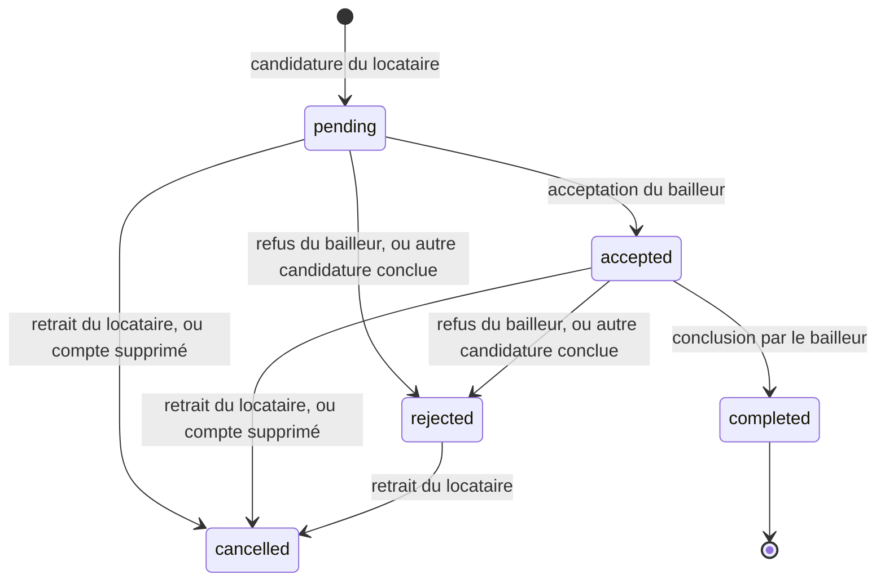
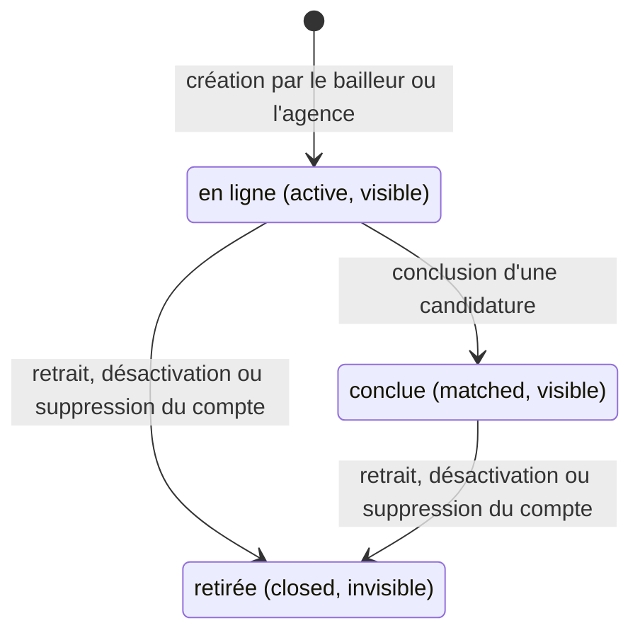
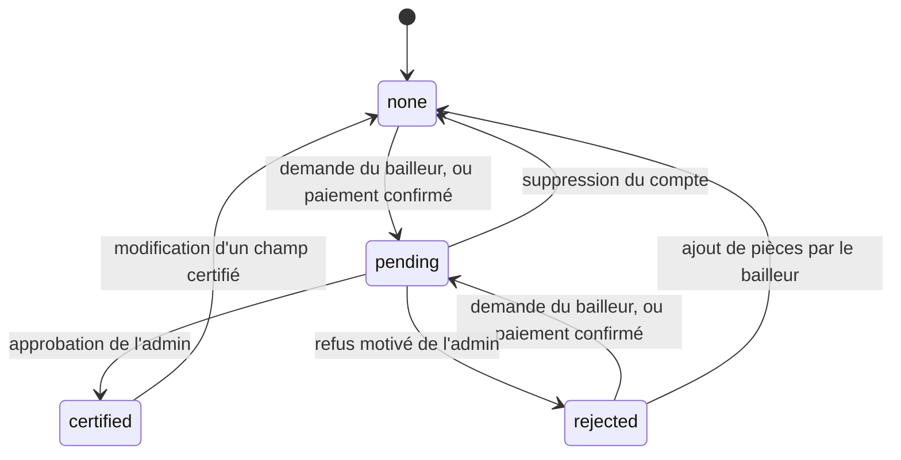
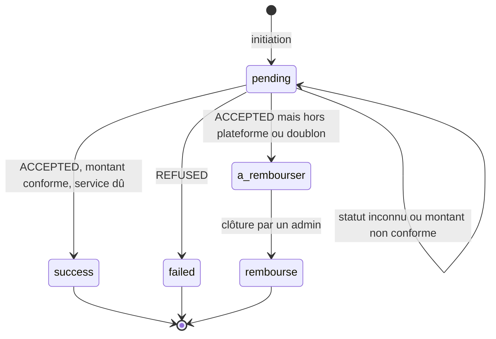
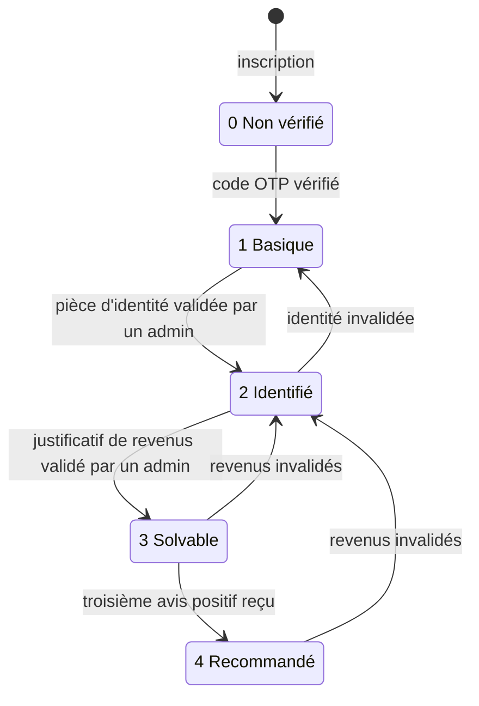
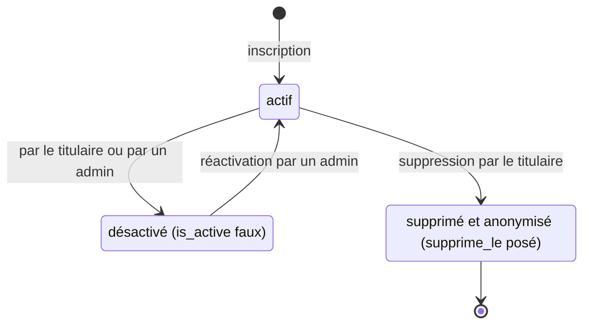
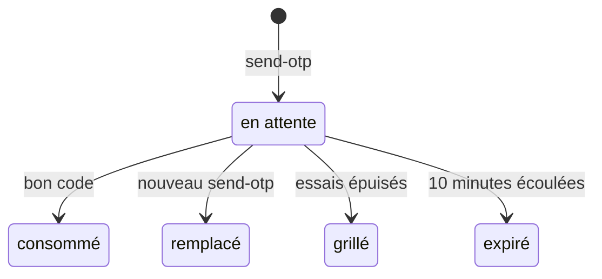

# Tcheyna : spécification technique

> **Source.** Ce document est tiré du code de `main` au commit `71d7c82`. Il est à confronter au PRD §6, absent du dépôt (rangé dans les fichiers du projet, sous `audit/`). Là où le PRD et ce document divergent, c'est le code qui est décrit ici, pas l'intention.
>
> **Lecture.** Chaque section décrit `main`, puis liste dans un encadré « Changements en PR (non mergés) » ce que chaque PR ouverte y change, avec son numéro. Relevé arrêté aux PR ouvertes jusqu'à #41, au 22/10/2026. **À chaque merge**, on déplace la ligne de la PR depuis l'encadré vers le corps de la section. L'encadré sert ainsi de liste de contrôle.
>
> **Renvois.** `fichier:fonction` désigne un chemin relatif à `backend/app/` (par exemple `routes/matches.py:create_match`), sauf mention contraire. Toutes les dates sont en UTC naïf (`datetime.utcnow()`), ce qui correspond à l'heure de Conakry (UTC+0, sans heure d'été).

## Sommaire

1. [Machines à états](#1-machines-à-états)
   1. [Candidature](#11-candidature-matchstatus) (`Match.status`)
   2. [Annonce](#12-annonce-listingstatus-et-listingis_visible) (`Listing.status`, `Listing.is_visible`)
   3. [Certification d'une annonce](#13-certification-dune-annonce-listingcertification_status) (`Listing.certification_status`)
   4. [Paiement](#14-paiement-paymentstatut) (`Payment.statut`)
   5. [Niveaux de confiance](#15-passeport-et-niveaux-de-confiance-usertrust_level) (`User.trust_level`)
   6. [Compte utilisateur](#16-compte-utilisateur)
   7. [Code OTP](#17-code-otp-otpcode)
2. [Contrat d'API](#2-contrat-dapi)
3. [Règles transverses](#3-règles-transverses)
4. [Questions ouvertes](#4-questions-ouvertes)
5. [Annexe : ordre de merge et conflits signalés](#5-annexe--ordre-de-merge-et-conflits-signalés)

---

## 1. Machines à états

### 1.1 Candidature (`Match.status`)

Valeurs : `pending`, `accepted`, `rejected`, `completed`, `cancelled` (`models.py:MATCH_STATUSES`). Une seule candidature par couple locataire-annonce (contrainte `uq_match_tenant_listing`).



| Transition | Déclencheur | Qui | Contrôles | Effets |
|---|---|---|---|---|
| → `pending` | `POST /api/matches/` (`routes/matches.py:create_match`) | locataire (`tenant`) | niveau ≥ 1, sinon 403 `action_requise: verifier_telephone` ; annonce `active` et visible, sinon 400 ; pas sa propre annonce (400) ; annonce certifiée : niveau ≥ 2, sinon 403 `action_requise: verifier_identite` ; une seule candidature par annonce (409) | score de compatibilité figé (`services/matching.py:score_compatibilite`) ; notification `nouvelle_candidature` au bailleur |
| `pending` → `accepted` | `PUT /api/matches/<id>/statut` `{"statut": "accepted"}` (`routes/matches.py:update_match_status`) | bailleur ou agence propriétaire de l'annonce (403 sinon) | statut courant `pending` ou `accepted`, sinon 409 | conversation créée si absente ; notification `candidature_acceptee` ; l'adresse exacte s'ouvre au locataire (`services/acces.py:STATUTS_OUVRANT_ADRESSE`) |
| `pending`/`accepted` → `rejected` | même route, `{"statut": "rejected"}` | idem | idem | notification `candidature_refusee` ; le passeport du candidat se ferme au bailleur (`services/acces.py:STATUTS_OUVRANT_PASSEPORT`) |
| `accepted` → `completed` | `PUT /api/matches/<id>/conclure` (`routes/matches.py:conclure_location`) | bailleur ou agence propriétaire | statut `accepted`, sinon 400 | `completed_at` ; annonce → `matched` ; les autres candidatures `pending`/`accepted` de l'annonce → `rejected`, chacune notifiée ; notification « Location conclue » (type `candidature_acceptee`) au locataire ; les avis s'ouvrent (`routes/reviews.py:create_review`) |
| `pending`/`accepted`/`rejected` → `cancelled` | `DELETE /api/matches/<id>` (`routes/matches.py:retirer_candidature`) | le locataire auteur (403 sinon) | refusé seulement si `completed` (400) | aucune notification |
| `pending`/`accepted` → `cancelled` | suppression d'un compte (`services/donnees_personnelles.py:anonymiser_compte`) | titulaire du compte, locataire ou bailleur | — | candidatures du locataire supprimé (message effacé) et candidatures reçues sur les annonces du bailleur supprimé |

Autres règles liées au statut :
- **Visite** : `PUT /api/matches/<id>/visite` (`routes/matches.py:planifier_visite`) fixe `visite_date`. Seulement sur une candidature `accepted` (400 sinon), par l'une des deux parties. La date n'est pas contrôlée (une date passée est acceptée). L'autre partie reçoit une notification (type `nouveau_message`).
- **Messagerie** : la conversation naît à l'acceptation. Sur `main`, l'écriture reste ouverte quel que soit le statut ultérieur (`routes/messages.py:envoyer_message` ne vérifie que la participation).
- **Commission** affichée : `Match.commission`, 6 % du loyer (`models.py:COMMISSION_RATE`), 0 pour une vente.

> [!NOTE]
> **Changements en PR (non mergés)**
> - **#33** (D1) : sur une **location**, `{"statut": "accepted"}` répond **402** (`action_requise: payer_frais_mise_en_relation`, bloc `paiement` avec montant et devise) et la candidature **reste `pending`**. Elle passe `accepted` à la confirmation du paiement des frais (`routes/payments.py:_confirmer` → `routes/matches.py:accepter_candidature`). Une vente s'accepte directement. Hors GNF : 400. Verrous dans l'ordre annonce, puis candidature (`_requete_candidature_verrouillee`), aussi à la création. `Match.commission` vaut toujours 0.
> - **#37** : `conclure_location` relit l'annonce, puis la candidature, sous verrou.
> - **#30** : écriture dans la conversation fermée si le statut n'est pas `pending`, `accepted` ou `completed` (donc après `rejected` ou `cancelled`) : 409 avec `motif` (`candidature_refusee`, `candidature_retiree`). Le fil reste lisible.
> - **#38** : `visite_date` doit être future et à moins de 365 jours (422 `date_passee`, `date_trop_lointaine`) ; une date avec fuseau est convertie en UTC. Rappel la veille par `flask visites rappeler` (candidatures `accepted` seulement). La confirmation par l'autre partie attend une migration, après #19.
> - D7 (5 candidatures actives au plus par locataire) : **aucune PR ouverte** ne l'applique (lot 2.5, bloqué par la migration en attente #19).

### 1.2 Annonce (`Listing.status` et `Listing.is_visible`)

Deux colonnes portent l'état : `status` (`active`, `matched`, `closed`) et `is_visible`. Il n'y a ni brouillon ni expiration.



| Transition | Déclencheur | Qui | Contrôles | Effets |
|---|---|---|---|---|
| → en ligne | `POST /api/listings/` (`routes/listings.py:create_listing`) | `landlord`, `agency` | schéma `CreationAnnonce` (pays parmi `MARCHES_OUVERTS`, ville du pays, loyer ≤ `LOYER_MAX`, devise déduite du pays) | `status=active`, `is_visible=True` ; aucune vérification du bailleur exigée |
| en ligne → conclue | `PUT /api/matches/<id>/conclure` | bailleur | voir 1.1 | `status=matched` ; l'annonce sort de la recherche (filtre `status=active`) mais reste lisible par son URL |
| → retirée | `DELETE /api/listings/<id>` (`routes/listings.py:delete_listing`) | propriétaire (403 sinon) | — | `is_visible=False`, `status=closed` ; candidatures inchangées |
| → retirée | `DELETE /api/users/me` (`routes/users.py:desactiver_compte`) | titulaire | — | toutes ses annonces retirées |
| → retirée | `POST /api/users/me/suppression` (`services/donnees_personnelles.py:anonymiser_compte`) | titulaire | — | annonces retirées, photos, pièces et adresse effacées, examen de certification en cours remis à `none`, candidatures `pending`/`accepted` annulées |

Règles liées à l'état :
- Recherche, recommandations et profil public ne montrent que `status=active` et `is_visible=True` (`routes/listings.py:get_listings`, `recommandations`, `routes/users.py:get_user`).
- Une annonce retirée n'est lisible que par son propriétaire, l'admin et ses candidats, sinon 404 (`services/acces.py:peut_voir_annonce`).
- Candidater exige `active` et visible (1.1). Modifier, ajouter des photos ou des pièces n'a pas de condition d'état.
- Aucune route ne remet en ligne une annonce retirée ; aucune ne fait sortir de `matched`.
- La désactivation d'un compte **par l'admin** ne touche pas à ses annonces (`routes/admin.py:basculer_statut`) : voir 4.2.
- Mise en avant (indépendante de l'état) : `is_premium` et `premium_until`, posés par un paiement `mise_en_avant` (+30 jours) ; seule la date compte (`models.py:Listing.premium_actif`).

> [!NOTE]
> **Changements en PR (non mergés)**
> - **#31** (D3) : `POST /api/listings/` exige un téléphone vérifié (`services/acces.py:publication_autorisee`), sinon 403 `details[0].code = telephone_non_verifie`. Les annonces déjà publiées ne sont pas touchées (question en 4.1).
> - **#37** : `PUT /api/listings/<id>/retirer` (idempotent ; `DELETE` en devient l'alias) et `PUT /api/listings/<id>/reactiver` (idempotent, soumis à `publication_autorisee` ; 409 `annonce_conclue` si l'annonce est `matched` ou a une candidature `completed`). Réactiver remet `status=active`, `is_visible=True`. `GET /mes-annonces?inclure_retirees=1` ; champs propriétaire `retiree` et `certification_resoumission`. Le retrait ne touche toujours pas aux candidatures (question en 4.1).
> - **#33** : `PUT /api/listings/<id>` refuse (409) de changer `type_transaction` tant qu'une candidature est `pending` ou `accepted` ; annonce relue sous verrou.
> - **#20** : `PUT /api/listings/<id>` relit l'annonce sous verrou (même bloc que #33).
> - **#39** (D6, fondée sur #37 et #31) : nouvelle transition en ligne → retirée, « 30 jours sans activité, après relance ». Une annonce en ligne sans activité depuis 30 jours est retirée (`_retirer`, comme un retrait par le bailleur) par `flask annonces expirer` (`routes/listings.py:expirer_annonces`, `_expirer`), après une relance à J-7.
>   - Activité = la plus récente de trois dates (`dernieres_activites`) : la publication (`created_at`), la dernière écriture du propriétaire (`updated_at`, y compris un formulaire enregistré sans changement) et la dernière candidature reçue.
>   - Un écouteur `before_update` (`_garder_date_d_activite`) laisse `updated_at` inchangé quand une écriture ne touche que des colonnes du système (`COLONNES_SYSTEME` : vues, décision de certification, mise en avant).
>   - Le retrait n'arrive jamais moins de 7 jours après la relance de la même échéance. Une annonce en mise en avant en cours n'est ni relancée ni retirée.
>   - Retrait journalisé (`verifications`, objet `annonce`, décision `expiree`). Notifications `annonce_bientot_expiree` et `annonce_expiree`. Candidatures inchangées.
>   - Nouvelle route `PUT /api/listings/<id>/confirmer` (propriétaire), idempotente : elle compte comme une activité. 409 `annonce_retiree` ou `annonce_conclue` si l'annonce n'est pas en ligne. Une annonce expirée se remet en ligne par `PUT /<id>/reactiver` (#37).

### 1.3 Certification d'une annonce (`Listing.certification_status`)

Valeurs : `none`, `pending`, `certified`, `rejected` (`models.py:CERTIFICATION_STATUSES`). Une annonce certifiée passe devant dans la recherche (après la mise en avant) et n'accepte que des candidats de niveau ≥ 2.



| Transition | Déclencheur | Qui | Contrôles | Effets |
|---|---|---|---|---|
| `none`/`rejected` → `pending` | `POST /api/listings/<id>/certification` (`routes/listings.py:demander_certification`) | propriétaire (403 sinon) | déjà `pending` : 409 ; déjà `certified` : 200 sans effet ; au moins une pièce (400) et une photo (400) ; si `CINETPAY_API_KEY` est configurée, un paiement `certification` réussi pour l'annonce, sinon 402 `paiement_requis: certification` | `certification_requested_at`, note effacée ; pas de notification |
| non certifiée → `pending` | confirmation d'un paiement `certification` (`routes/payments.py:_confirmer`) | CinetPay, via callback ou vérification | aucun contrôle des pièces ni des photos (voir 4.2) | `certification_requested_at` |
| `pending` → `certified` | `PUT /api/admin/certifier/<id>` `{"approuve": true}` (`routes/admin.py:certifier_annonce`) | admin | aucun contrôle de l'état courant (voir 4.2) | `certified_at`, note = motif ; journal `verifications` (`certification_annonce`, `approuvee`) ; notification `annonce_certifiee` |
| `pending` → `rejected` | même route, `{"approuve": false, "motif": …}` | admin | motif obligatoire (400) | journal (`refusee`) ; notification `annonce_refusee` avec le motif ; les pièces sont conservées |
| `rejected` → `none` | `POST /api/listings/<id>/documents` (`routes/listings.py:televerser_documents`) | propriétaire | au plus 6 pièces (`MAX_DOCUMENTS`) | permet une nouvelle demande |
| `certified` → `none` | `PUT /api/listings/<id>` (`routes/listings.py:update_listing`) | propriétaire | un champ de `CHAMPS_CERTIFIES` change : `adresse`, `quartier`, `ville`, `type_bien`, `type_transaction`, `superficie` | `certified_at` effacé, note « Certification annulée : les caractéristiques du bien ont été modifiées. » |
| `pending` → `none` | suppression du compte (`services/donnees_personnelles.py:anonymiser_compte`) | titulaire | — | — |

Autres règles : retirer une pièce est refusé pendant l'examen (409, `routes/listings.py:supprimer_document`). Les pièces de propriété ne sont jamais publiques : liens signés pour le propriétaire et l'admin (`lister_documents`, `routes/admin.py:certifications_pending`).

> [!NOTE]
> **Changements en PR (non mergés)**
> - **#20** : `CHAMPS_CERTIFIES` couvre aussi `pays`, `nb_pieces`, `etage`, `meuble` et les six équipements ; la comparaison porte sur l'état enregistré avant et après (`_etat_certifie`). Ajouter ou retirer une photo annule la certification (`_annuler_certification`) ; réordonner, non. Retirer une pièce d'une annonce certifiée : 409. Pendant `pending`, modifier un champ certifié, ajouter ou retirer une photo : 409 (`_refus_pendant_examen`) ; prix, textes et ordre des photos restent modifiables.
> - **#37** (D4) : une re-soumission après refus est gratuite une fois par annonce, payante ensuite (`routes/listings.py:etats_certification`, `RESOUMISSIONS_GRATUITES = 1`, calcul rejoué sur le journal `verifications` et les paiements, sans migration). Le 402 porte `certification_resoumission`. `/payments/initier` refuse une certification (409) si l'annonce est certifiée, en examen ou retirée. `_service_deja_regle` passe par `certification_a_payer`.

### 1.4 Paiement (`Payment.statut`)

Valeurs : `pending`, `success`, `failed`, `a_rembourser`, `rembourse` (`models.py:Payment`, `schemas/payments.py:A_REMBOURSER`, `REMBOURSE`). Types : `PAYMENT_TYPES` de `models.py`. Le montant et la devise sont toujours fixés par le serveur (`routes/payments.py:_montant_attendu`). Le statut n'est jamais lu dans le corps d'un callback : il est revérifié auprès de CinetPay (`_verifier_aupres_de_cinetpay`), puis appliqué une seule fois sous verrou (`_appliquer_verification`).



| Transition | Déclencheur | Qui | Contrôles | Effets |
|---|---|---|---|---|
| → `pending` | `POST /api/payments/initier` (`routes/payments.py:initier_paiement`) | utilisateur connecté ; 10 par minute par compte | `caution` et `premier_loyer` refusés par le schéma (422 `hors_plateforme`, D2) ; match ou annonce d'autrui : 403 ; commission réglée par le bailleur seulement (403) ; commission : candidature `accepted` ou `completed` d'une location ; certification et mise en avant : `listing_id` requis ; abonnement : locataire sans abonnement en cours ; paiement en attente du même service revérifié d'abord (409 s'il vient d'être confirmé, ou s'il a moins de 30 min) ; service déjà réglé (commission, certification, abonnement) : 409 ; tarifs fixes en GNF seulement (400) | référence `TCH-XXXXXXXX` ; sans `CINETPAY_API_KEY` : reste `pending`, `mode: hors_ligne` ; CinetPay injoignable 503, illisible 502, refus d'initiation 400 |
| `pending` → `success` | `POST /api/payments/callback` (webhook), `POST /api/payments/<id>/verifier` (payeur), ou reprise à l'initiation | CinetPay | `ACCEPTED`, montant et devise conformes (`_montant_conforme`), aucun motif de remboursement | `paid_at` ; certification : annonce → `pending` ; mise en avant : `premium_until` prolongé de 30 jours ; notification `paiement_recu` |
| `pending` → `failed` | idem | CinetPay | `REFUSED` explicite | — |
| `pending` → `a_rembourser` | idem | CinetPay | `ACCEPTED` mais type hors plateforme, ou service déjà réglé (`_motif_remboursement`) | notification `paiement_a_rembourser` au payeur et à chaque admin |
| `pending` reste `pending` | idem | — | statut inconnu, panne, ou montant non conforme (journalisé en erreur) | aucun ; un client a peut-être été débité |
| `a_rembourser` → `rembourse` | `PUT /api/admin/paiements/<id>/rembourse` (`routes/admin.py:marquer_rembourse`) | admin, après remboursement manuel dans le back-office CinetPay | statut `a_rembourser`, sinon 409 | notification `paiement_rembourse` |

Tarifs (`routes/payments.py:TARIFS_GNF`) : certification 250 000 GNF, abonnement Passeport 150 000 GNF (un an, `models.py:DUREE_ABONNEMENT_PASSEPORT`), mise en avant 200 000 GNF (30 jours) ; commission 6 % du loyer.

> [!NOTE]
> **Changements en PR (non mergés)**
> - **#33** (D1) : nouveau type `frais_mise_en_relation`, 250 000 GNF, payé par le bailleur sur une candidature de location encore `pending` ; un seul paiement réussi par candidature. Sa confirmation accepte la candidature (1.1). Motif de remboursement `candidature_close` si la candidature n'est plus `pending` à la confirmation. `commission` n'est plus initiable (422 `type_retire`), mais reste lisible. `/payments/tarifs` perd son bloc `commission` et gagne l'entrée des frais (champ `moment`). `COMMISSION_RATE` est supprimée.
> - **#37** (D4) : un paiement `certification` n'est admis que si une nouvelle demande l'exige (`certification_a_payer`).

### 1.5 Passeport et niveaux de confiance (`User.trust_level`)

Le niveau est **stocké** et recalculé par `models.py:User.update_trust_level`. Les niveaux sont cumulatifs : perdre une vérification fait redescendre au dernier niveau dont toutes les conditions tiennent.

| Niveau | Libellé (`TRUST_LEVELS`) | Condition | Ce qu'il ouvre dans le code |
|---|---|---|---|
| 0 | Non vérifié | compte créé | consultation |
| 1 | Basique | `phone_verified` | candidater (`routes/matches.py:NIVEAU_MIN_CANDIDATURE`) ; figurer dans les candidats suggérés ; points de compatibilité (voir sous le tableau) |
| 2 | Identifié | 1 et `cni_verified` | candidater à une annonce certifiée (`NIVEAU_MIN_ANNONCE_CERTIFIEE`) ; points de compatibilité |
| 3 | Solvable | 2 et `income_verified` | points de compatibilité |
| 4 | Recommandé | 3 et au moins 3 avis positifs reçus (`is_positive`, note ≥ 4) | points de compatibilité ; étape 4 du passeport marquée faite (`routes/passport.py:_etapes_verification`) |

À tous les niveaux, le score de compatibilité locataire-annonce lit `trust_level` : le critère « Confiance » donne `int(POIDS["confiance"] * 0.5 * min(niveau, 4) / 4)` points (`services/matching.py:score_compatibilite`). Ce score sert au tri « match » de la recherche, aux recommandations, aux candidats suggérés et au tri des candidatures reçues.



Montées :
- 0 → 1 : `POST /api/auth/verify-otp` (`routes/auth.py:verify_otp`) ; notification `niveau_confiance`.
- 1 → 2 : `PUT /api/admin/verify-cni/<id>` `{"approuve": true}` (`routes/admin.py:verify_cni`), seulement si une pièce est déposée (sinon 422 `piece_absente`).
- 2 → 3 : `PUT /api/admin/verify-revenus/<id>` `{"approuve": true}` (`routes/admin.py:verify_revenus`), seulement si un justificatif est déposé.
- 3 → 4 : `POST /api/reviews/` (`routes/reviews.py:create_review`), qui recalcule le niveau de la cible.

Chaque décision admin est journalisée (`services/donnees_personnelles.py:consigner`, table `verifications`) et la pièce est supprimée dès la décision, validée ou refusée (D5).

Descentes :
- `cni_verified` repasse à faux quand une pièce d'identité est déposée de nouveau ou retirée (`routes/passport.py:upload_document`, `supprimer_document`), ou à un refus admin. Le niveau tombe alors à 1 au plus, quels que soient les revenus.
- `income_verified` repasse à faux à un nouveau justificatif, à son retrait, à un refus admin, ou quand `POST /api/passport/` déclare un autre `revenu_mensuel` (`routes/passport.py:create_or_update_passport`).
- `phone_verified` ne repasse jamais à faux sur `main`, sauf à la suppression du compte (`send-otp` répond « déjà vérifié » avant tout changement de numéro).
- Suppression du compte : niveau 0 (`anonymiser_compte`).
- La purge des pièces sans décision (D5) ne retire aucune vérification acquise : elle ne porte que sur des pièces non validées.

Le score du passeport (0 à 100, `models.py:TenantPassport.calculate_score`) est distinct du niveau.

> [!NOTE]
> **Changements en PR (non mergés)**
> - **#24** : niveau 4 = avis positifs de **3 auteurs distincts** (`models.py:AUTEURS_POSITIFS_NIVEAU_4`, `User.nb_auteurs_positifs`). La note moyenne donne une voix par auteur (`moyenne_par_auteur`). Un locataire auteur d'un avis est réduit à « Prénom I. » (`auteur_public`). Effet différé : un niveau 4 existant n'est revu qu'au prochain recalcul.
> - **#35** (D12) : la vérification des revenus expire 90 jours après le dépôt du justificatif validé (`revenus_deposes_le` conservé à la validation). Relance à J-7, puis retrait de la vérification et recalcul du niveau, par `flask donnees expirer-revenus` (`services/donnees_personnelles.py:appliquer_validite_revenus`). Deux nouvelles décisions au journal : `relancee`, `expiree`.
> - **#31** (D3) : badge calculé `proprietaire_verifie` = bailleur ou agence avec `cni_verified` (`models.py:User.proprietaire_verifie`), exposé dans `User.to_dict`. Ce n'est pas un niveau. Un bailleur ne peut pas encore déposer de pièce (dépôt réservé au rôle `tenant`), donc le badge vaut faux en production.

### 1.6 Compte utilisateur

Trois états, portés par `is_active` et `supprime_le`.



| Transition | Déclencheur | Qui | Contrôles | Effets |
|---|---|---|---|---|
| → actif | `POST /api/auth/register` (`routes/auth.py:register`) | public ; 5 par heure par IP | rôle `tenant`, `landlord` ou `agency` (un admin se crée par `backend/create_admin.py`) ; e-mail et téléphone uniques (409) | locataire : passeport créé ; jetons émis |
| actif → désactivé | `DELETE /api/users/me` (`routes/users.py:desactiver_compte`) | titulaire | — | jetons révoqués ; toutes ses annonces retirées ; pas de ligne au journal |
| actif → désactivé | `PUT /api/admin/users/<id>/statut` (`routes/admin.py:basculer_statut`) | admin, pas sur lui-même (400) | `is_active` absent : bascule | jetons révoqués ; journal `statut_compte`/`desactivation` ; annonces inchangées |
| désactivé → actif | même route | admin | compte supprimé : 409 | journal `activation` ; les jetons révoqués ne revivent pas ; les annonces retirées le restent |
| actif → supprimé | `POST /api/users/me/suppression` (`routes/users.py:supprimer_compte`) | titulaire non admin (403) ; 5 par heure par IP | mot de passe exigé (422 si faux) | `services/donnees_personnelles.py:anonymiser_compte` : fichiers supprimés, passeport effacé, annonces retirées et vidées, candidatures en cours annulées, favoris, notifications et codes OTP effacés, e-mail remplacé, mot de passe inutilisable, niveau 0, jetons révoqués |

Effets d'un compte désactivé :
- Avec un jeton émis avant la désactivation : 401 « Session révoquée ». La désactivation et la suppression appellent `revoquer_jetons`, et `__init__.py:jeton_revoque` passe avant tout autre contrôle.
- Connexion : 403 « Compte désactivé ». Les contrôles 403 de `routes/auth.py:refresh` et de `routes/__init__.py:role_required` existent aussi, mais un ancien jeton y est déjà refusé en 401.
- Le reste : `GET /api/users/<id>` répond 404 ; il disparaît des candidats suggérés ; il n'a plus de droit sur les passeports et les adresses (`services/acces.py`).

> [!NOTE]
> **Changements en PR (non mergés)**
> - **#22** : `POST /api/auth/logout` révoque les jetons du compte, sur tous les appareils. Connexion : deux limites de plus sur les échecs (50 par 15 min par IP, 30 par heure par e-mail). Changement de mot de passe : 5 par heure par compte.
> - **#32** : connexion par numéro **vérifié** dans le champ `email` (pas pour un admin) ; mot de passe oublié par SMS en deux routes ; la réinitialisation révoque les jetons.
> - **#27** (web) : le bouton de déconnexion appelle `POST /api/auth/logout` (après #22).
> - **#21** : la suppression du compte garde ses lignes `otp_codes`, vidées du numéro et des secrets, pour qu'elles restent comptées dans le plafond global des SMS.

### 1.7 Code OTP (`OTPCode`)

Un code de 6 chiffres (`secrets`), stocké sous forme de HMAC-SHA256 lié à la ligne (`routes/auth.py:hacher_otp`, clé `OTP_HMAC_KEY` ou dérivée de `SECRET_KEY`), valable 10 minutes, 5 essais. La colonne `code` en clair est obsolète.



- **Envoi** : `POST /api/auth/send-otp` (`routes/auth.py:send_otp`), utilisateur connecté, ligne du compte verrouillée. Numéro normalisé (`normaliser_phone`, `+224` par défaut) et contrôlé (`PHONE_RE`, 400). Téléphone déjà vérifié : 200 sans envoi. Anti-spam 60 s, 5 codes par compte et 5 par numéro sur 24 h glissantes, comptés en base (429 avec `reessayer_dans`). Numéro d'un autre compte : 409. Les codes précédents non utilisés passent `is_used`. SMS par Africa's Talking (`send_sms_otp`) ; sans clé et en `DEBUG`, la réponse contient `debug_code`.
- **Vérification** : `POST /api/auth/verify-otp` (`routes/auth.py:verify_otp`). Dernier code non utilisé ; essai décompté avant la comparaison par un `UPDATE` conditionnel ; comparaison à temps constant ; consommation atomique. Erreurs : aucun code ou code sans empreinte, expiré, incorrect ou déjà utilisé : 400 ; essais épuisés : 429 et code grillé ; numéro du compte changé depuis l'envoi : 409. Succès : `phone_verified`, niveau recalculé, score du passeport recalculé.

> [!NOTE]
> **Changements en PR (non mergés)**
> - **#21** : plafond global de 100 codes par heure et 500 par 24 h, tous comptes confondus (`_plafond_global`, 429), alerte dans les journaux à 80 % ; numéro et code masqués dans les journaux (`masquer_numero`).
> - **#32** : codes de réinitialisation du mot de passe dans la même table, séparés par le domaine du HMAC (`hacher_otp_reinitialisation`) ; mêmes durée, essais et quotas, partagés entre les deux usages ; soumis au plafond de #21 (la branche contient #21).

---

## 2. Contrat d'API

### 2.1 Généralités

- **Source de vérité, une fois #18 mergée** : `backend/openapi.json`, généré par `flask api spec` depuis `app.url_map`, `role_required` et `valider_corps` (`openapi.py`), avec les modèles de réponse de `schemas/reponses.py`. La CI refuse une spécification ou des types TypeScript en retard. Les tableaux ci-dessous sont alors un résumé lisible ; en cas d'écart, le fichier fait foi.
- **Préfixes** : un blueprint par préfixe `/api/<nom>` (`__init__.py:create_app`). Hors API : `GET /health` (public) et `GET /uploads/<fichier>` (développement et tests seulement, préfixes `annonce-` et `profil-` seulement, sinon 404).
- **Corps** : JSON validé par un schéma Pydantic (`schemas/__init__.py:valider_corps`) : champ inconnu refusé (`extra="forbid"`), longueurs bornées comme les colonnes, caractère NUL refusé. Corps illisible : 400. Les téléversements sont en `multipart/form-data` (champ `file`, ou `files` pour plusieurs), 10 Mo au plus (413).
- **Format d'erreur** : `{"error": "<message en français, affichable>", "details": [...]}`. Sur un 422, `details` liste `{champ, code, message}` (`schemas/__init__.py:reponse_422`, `erreur_champ`) ; `code` est stable. Sur `main`, `details` est toujours présent dans les réponses des gestionnaires globaux (400, 404, 405, 413, 415, 429, 500), des 401 JWT et des 422, mais **beaucoup d'erreurs de route renvoient `{"error"}` seul** (dont les 403 et 404 de `role_required`). Un client traite donc `details` comme facultatif, comme le fait le modèle `Erreur` de #18. Champs supplémentaires selon la route : `action_requise`, `paiement_requis`, `reessayer_dans` (429), `ajoutees`/`ajoutes` (envoi partiel).
- **Authentification** : `Authorization: Bearer <jeton>`. Jeton d'accès 2 h, de rafraîchissement 30 jours (`backend/config.py`). Chaque jeton porte `sub` (identifiant du compte) et `tv` (`token_version`, `routes/auth.py:emettre_tokens`). `__init__.py:jeton_revoque` refuse tout jeton dont `tv` diffère de `users.token_version` (401 « Session révoquée ») ; un jeton sans `tv` vaut 0. `User.revoquer_jetons` incrémente la version en SQL : changement de mot de passe, désactivation, suppression. `POST /api/auth/refresh` (jeton de rafraîchissement) ne renvoie qu'un nouveau jeton d'accès. `role_required` relit le compte : absent 404, désactivé 403, rôle non admis 403. 401 : jeton absent, invalide, expiré ou révoqué.
- **Limites de débit** : flask-limiter, fenêtre glissante, stockage `memory://` par défaut (chaque worker compte à part : de 1 à 2 fois le quota affiché), clé par défaut l'IP rendue fiable par ProxyFix (`TRUSTED_PROXY_HOPS = 1`). Le quota de SMS est compté en base, hors flask-limiter. 429 : `reessayer_dans` dans le corps et en-tête `Retry-After`.
- **Paramètres communs** : `lang=fr|en` sur les lectures d'annonces ; pagination `page`, `per_page`.

### 2.2 Routes

Légende de la colonne Accès : **public** (sans jeton), **public+** (jeton facultatif, qui enrichit la réponse), **connecté** (tout rôle actif), sinon le ou les rôles exigés (`tenant`, `landlord`, `agency`, `admin`). Fonctions dans `routes/<blueprint>.py`.

#### `auth` (`/api/auth`)

| Méthode et chemin | Accès | Corps | Réponses notables | Débit | Fonction |
|---|---|---|---|---|---|
| `POST /register` | public | `Inscription` | 201 avec jetons ; 400 téléphone invalide ; 409 e-mail ou téléphone pris | 5/h par IP | `register` |
| `POST /login` | public | `Connexion` | 401 identifiants incorrects (temps égalisé) ; 403 compte désactivé | 10/15 min par IP + e-mail, échecs seulement | `login` |
| `POST /refresh` | jeton de rafraîchissement | — | 401 compte introuvable ; 403 désactivé | — | `refresh` |
| `GET /me` | connecté | — | profil privé, `niveau`, `prochain_niveau` | — | `me` |
| `PUT /password` | connecté | `ChangementMotDePasse` | 422 `mot_de_passe_incorrect` (et non 401) ; 200 avec nouveaux jetons, autres sessions révoquées | — | `change_password` |
| `POST /send-otp` | connecté | `EnvoiOTP` | 400 ; 409 numéro d'un autre compte ; 429 (voir 1.7) | quotas en base | `send_otp` |
| `POST /verify-otp` | connecté | `VerificationOTP` | 400 ; 409 ; 429 essais épuisés | — | `verify_otp` |
| `GET /niveaux` | public | — | grille `TRUST_LEVELS` | — | `niveaux` |

#### `users` (`/api/users`)

| Méthode et chemin | Accès | Corps | Réponses notables | Débit | Fonction |
|---|---|---|---|---|---|
| `GET /<user_id>` | public+ | — | 404 inconnu ou désactivé ; locataire : nom réduit, sans photo, bio ni quartier, sauf pour qui peut lire son passeport | — | `get_user` |
| `PUT /me` | connecté | `MajProfil` | mise à jour partielle (`avatar_url` exclu) | — | `update_profile` |
| `DELETE /me` | connecté | — | désactivation (1.6) | — | `desactiver_compte` |
| `POST /me/suppression` | connecté, pas `admin` | `SuppressionCompte` | 403 admin ; 422 mot de passe | 5/h par IP | `supprimer_compte` |
| `POST /me/avatar` | connecté | multipart `file` | 400 ; 422 image illisible | — | `televerser_avatar` |
| `DELETE /me/avatar` | connecté | — | — | — | `supprimer_avatar` |

#### `listings` (`/api/listings`)

| Méthode et chemin | Accès | Corps | Réponses notables | Débit | Fonction |
|---|---|---|---|---|---|
| `GET /` | public+ | paramètres : `page`, `per_page` (≤ 50), `pays`, `ville`, `quartier`, `type`, `transaction`, `prix_min`, `prix_max`, `nb_pieces_min`, `surface_min`, `has_water`, `has_generator`, `has_wifi`, `is_secured`, `has_parking`, `has_ac`, `meuble`, `certified_only`, `q`, `tri` (`recent`, `prix_asc`, `prix_desc`, `surface`, `match` pour un locataire) | mise en avant puis certifiée en tête ; connecté : `is_favorite` ; locataire : `score_compatibilite` | — | `get_listings` |
| `GET /recommandations` | `tenant` | `limite` (≤ 30) | locations seulement | — | `recommandations` |
| `GET /mes-annonces` | `landlord`, `agency` | — | annonces visibles du bailleur, adresse comprise | — | `mes_annonces` |
| `GET /<id>` | public+ | — | 404 si retirée et lecteur sans droit ; compteur de vues ; locataire : `ma_candidature` | — | `get_listing` |
| `POST /` | `landlord`, `agency` | `CreationAnnonce` | 201 ; 422 `lieu_invalide`, `devise_incoherente`, `montant_trop_eleve` | — | `create_listing` |
| `PUT /<id>` | propriétaire | `MajAnnonce` | 403 ; 422 ; annule la certification (1.3) | — | `update_listing` |
| `DELETE /<id>` | propriétaire | — | retrait logique | — | `delete_listing` |
| `POST /<id>/certification` | propriétaire | — | 400 sans pièce ou sans photo ; 402 `paiement_requis` ; 409 déjà en examen | — | `demander_certification` |
| `POST /<id>/photos` | propriétaire | multipart `files` ou `file` | 201 ajout ; 200 doublon reconnu ; 400 au-delà de 10 photos ; 422 image illisible | — | `televerser_photos` |
| `DELETE /<id>/photos` | propriétaire | `UrlFichier` | 404 photo inconnue | — | `supprimer_photo` |
| `PUT /<id>/photos/ordre` | propriétaire | `OrdrePhotos` | 400 si ce n'est pas une permutation des photos actuelles | — | `reordonner_photos` |
| `POST /<id>/documents` | propriétaire | multipart `files` ou `file` | 201 ; 400 au-delà de 6 pièces ou fichier refusé | — | `televerser_documents` |
| `GET /<id>/documents` | propriétaire ou `admin` | — | liens signés temporaires (`null` si impossible) | — | `lister_documents` |
| `DELETE /<id>/documents` | propriétaire | `UrlFichier` | 404 ; 409 pendant l'examen | — | `supprimer_document` |

« propriétaire » : rôle `landlord` ou `agency` et propriétaire de l'annonce, sinon 403.

#### `matches` (`/api/matches`)

| Méthode et chemin | Accès | Corps | Réponses notables | Débit | Fonction |
|---|---|---|---|---|---|
| `POST /` | `tenant` | `Candidature` | 201 ; 403 `action_requise` ; 400 ; 409 (voir 1.1) | — | `create_match` |
| `GET /mes-candidatures` | `tenant` | `statut` | candidatures et compteurs | — | `mes_candidatures` |
| `GET /mes-demandes` | `landlord`, `agency` | `statut`, `listing_id` | passeport public du candidat tant que la candidature l'ouvre | — | `mes_demandes` |
| `GET /candidats-suggeres` | `landlord`, `agency` | `listing_id` (requis, 400), `limite` (≤ 30) | 403 annonce d'autrui ; profils réduits, score ≥ 50, abonnés Passeport en tête | — | `candidats_suggeres` |
| `GET /<id>` | les deux parties, `admin` | — | 404 pour tout autre lecteur (pas d'oracle) | — | `get_match` |
| `PUT /<id>/statut` | `landlord`, `agency` propriétaire | `DecisionCandidature` | 403 ; 409 | — | `update_match_status` |
| `PUT /<id>/visite` | les deux parties | `Visite` | 403 ; 400 si non acceptée | — | `planifier_visite` |
| `PUT /<id>/conclure` | `landlord`, `agency` propriétaire | — | 403 ; 400 si non acceptée | — | `conclure_location` |
| `DELETE /<id>` | `tenant` auteur | — | 403 ; 400 si conclue | — | `retirer_candidature` |

#### `passport` (`/api/passport`)

| Méthode et chemin | Accès | Corps | Réponses notables | Débit | Fonction |
|---|---|---|---|---|---|
| `GET /` | `tenant` | — | passeport privé, `etapes`, `abonnement` | — | `get_passport` |
| `POST /` | `tenant` | `MajPasseport` | situation, revenus, garant | — | `create_or_update_passport` |
| `PUT /preferences` | `tenant` | `Criteres` | 422 `budget_incoherent` | — | `update_preferences` |
| `POST /upload/<doc_type>` | `tenant` | multipart `file` ; `doc_type` : `cni_recto`, `cni_verso`, `passport`, `income` | 400 type ou fichier refusé | — | `upload_document` |
| `DELETE /upload/<doc_type>` | `tenant` | — | 400 type | — | `supprimer_document` |
| `GET /<tenant_id>` | connecté | — | complet pour le locataire et l'admin, public pour un bailleur à qui il a candidaté ; 404 sinon | — | `voir_passeport` |

#### `messages` (`/api/messages`)

| Méthode et chemin | Accès | Corps | Réponses notables | Débit | Fonction |
|---|---|---|---|---|---|
| `GET /conversations` | connecté | — | conversations du compte, `non_lus` | — | `liste_conversations` |
| `GET /conversations/<id>` | participant | — | 403 ; fil complet, messages reçus marqués lus | — | `get_conversation` |
| `POST /conversations/<id>` | participant | `NouveauMessage` | 201 ; 403 | — | `envoyer_message` |
| `GET /par-match/<match_id>` | participant | — | 404 sans conversation ; 403 | — | `conversation_par_match` |
| `GET /non-lus` | connecté | — | compteur | — | `compteur_non_lus` |

#### `favorites`, `notifications`, `reviews`, `geo`

| Méthode et chemin | Accès | Corps | Réponses notables | Fonction |
|---|---|---|---|---|
| `GET /api/favorites/` | connecté | — | annonces visibles seulement | `favorites.liste_favoris` |
| `POST /api/favorites/<listing_id>` | connecté | — | 201 ; 200 si déjà présent ; 404 annonce | `favorites.ajouter_favori` |
| `DELETE /api/favorites/<listing_id>` | connecté | — | 200 dans tous les cas | `favorites.retirer_favori` |
| `GET /api/notifications/` | connecté | `limite` (≤ 100), `non_lues` | — | `notifications.liste` |
| `GET /api/notifications/non-lues` | connecté | — | compteur | `notifications.compteur` |
| `PUT /api/notifications/<id>/lue` | connecté | — | 403 notification d'autrui | `notifications.marquer_lue` |
| `PUT /api/notifications/tout-lire` | connecté | — | — | `notifications.tout_marquer_lu` |
| `DELETE /api/notifications/<id>` | connecté | — | 403 notification d'autrui | `notifications.supprimer` |
| `GET /api/reviews/user/<user_id>` | public | — | 404 ; avis, moyenne, répartition | `reviews.get_user_reviews` |
| `GET /api/reviews/a-donner` | connecté | — | locations conclues pas encore notées | `reviews.avis_a_donner` |
| `POST /api/reviews/` | partie à la location | `Avis` | 201 ; 400 non conclue ; 403 pas partie ; 409 déjà noté | `reviews.create_review` |
| `GET /api/geo/pays` | public | — | pays, devise, marché ouvert | `geo.get_pays` |
| `GET /api/geo/villes/<pays>` | public | — | 404 | `geo.get_villes` |
| `GET /api/geo/quartiers/<pays>/<ville>` | public | — | 404 | `geo.get_quartiers` |
| `GET /api/geo/referentiel` | public | — | lieux, devises, types de bien, marchés ouverts | `geo.referentiel` |

#### `payments` (`/api/payments`)

| Méthode et chemin | Accès | Corps | Réponses notables | Débit | Fonction |
|---|---|---|---|---|---|
| `GET /tarifs` | public | — | services et commission | — | `tarifs` |
| `POST /initier` | connecté | `InitierPaiement` | voir 1.4 (400, 403, 409, 422, 502, 503) | 10/min par compte (sinon IP) | `initier_paiement` |
| `POST /callback` | public (webhook CinetPay) | `CallbackCinetPay`, JSON ou formulaire, champs inconnus ignorés | 200 pour tout corps valide, transaction inconnue ou déjà traitée comprises ; 400 ou 422 si `cpm_trans_id` manque ou si le corps est illisible ; 429 au-delà de la limite ; statut revérifié auprès de CinetPay | 60/min par IP | `cinetpay_callback` |
| `GET /mes-paiements` | connecté | `statut` | paiements du compte, `total_paye` | — | `mes_paiements` |
| `GET /<id>` | payeur, parties de la candidature, `admin` | — | 403 ; reçu | — | `recu` |
| `POST /<id>/verifier` | payeur | — | 403 ; revérification d'un paiement `pending` | 10/min par IP | `verifier_paiement` |

#### `admin` (`/api/admin`, rôle `admin` partout)

| Méthode et chemin | Corps | Réponses notables | Fonction |
|---|---|---|---|
| `GET /diagnostic` | — | état de la configuration, sans secret | `diagnostic` |
| `GET /stats` | — | tableau de bord ; caution et loyer historiques comptés à part | `stats` |
| `GET /cni-pending` | — | file des pièces d'identité, liens signés | `cni_pending` |
| `PUT /verify-cni/<user_id>` | `Decision` | 422 `piece_absente` si approuvée sans pièce ; refus sans pièce : demande classée | `verify_cni` |
| `GET /revenus-pending` | — | file des justificatifs | `revenus_pending` |
| `PUT /verify-revenus/<user_id>` | `Decision` | 404 sans passeport ; 422 `piece_absente` | `verify_revenus` |
| `GET /certifications-pending` | — | annonces en examen, pièces en liens signés | `certifications_pending` |
| `PUT /certifier/<listing_id>` | `Decision` | 400 refus sans motif | `certifier_annonce` |
| `GET /paiements-a-rembourser` | — | motif `hors_plateforme` ou `doublon` | `paiements_a_rembourser` |
| `PUT /paiements/<id>/rembourse` | `Remboursement` | 404 ; 409 si pas `a_rembourser` | `marquer_rembourse` |
| `GET /users` | paramètres `page`, `per_page` (≤ 200), `role`, `q` | — | `list_users` |
| `PUT /users/<user_id>/statut` | `StatutCompte` | 400 sur soi-même ; 409 compte supprimé | `basculer_statut` |

> [!NOTE]
> **Changements en PR (non mergés)**
> - **#18** : `backend/openapi.json` (OpenAPI 3.1), `flask api spec [--check]`, `x-roles` par opération, modèles stricts de `schemas/reponses.py` validés contre chaque `to_dict()` pendant les tests, types `frontend/src/api/schema.gen.ts`. Les réponses de succès ne sont pas encore décrites route par route. Après #18, toute PR qui touche à l'API met à jour `reponses.py` et régénère la spécification (règle ajoutée à `docs/agents/LANES.md`).
> - **#22** : `POST /api/auth/logout` (jeton d'accès ou de rafraîchissement) ; `POST /login` : + 50/15 min par IP et 30/h par e-mail, échecs seulement ; `PUT /password` : 5/h par compte.
> - **#32** : `POST /login` accepte un numéro vérifié dans `email` (+ 10/15 min par IP + numéro et 30/h par numéro, échecs seulement) ; `POST /api/auth/mot-de-passe-oublie` (`DemandeReinitialisation` ; même réponse 200 dans tous les cas ; 10/h par IP, 5/h par numéro) ; `POST /api/auth/mot-de-passe-oublie/confirmer` (`ConfirmationReinitialisation` ; un seul refus 400 pour tous les échecs ; 20/h par IP et 10/h par numéro sur les échecs) ; 422 `telephone_invalide`.
> - **#21** : `POST /send-otp` : 429 « service momentanément saturé » au plafond global.
> - **#31** : `POST /api/listings/` : 403 `telephone_non_verifie` ; `proprietaire_verifie` dans `User`.
> - **#37** : `PUT /api/listings/<id>/retirer`, `PUT /api/listings/<id>/reactiver` (403 `telephone_non_verifie`, 409 `annonce_conclue`) ; `GET /mes-annonces?inclure_retirees=1` ; champs propriétaire `retiree`, `certification_resoumission` ; 402 de certification enrichi ; `/payments/initier` : 409 pour une certification sans objet.
> - **#39** : `PUT /api/listings/<id>/confirmer` (`landlord` ou `agency` propriétaire ; 200 avec `expiration_prevue` ; 409 `annonce_retiree`, `annonce_conclue`) ; `PUT /<id>` compte comme une activité, même sans changement.
> - **#20** : 409 pendant l'examen sur `PUT /<id>` (champ certifié), `POST`/`DELETE /<id>/photos` ; 409 sur `DELETE /<id>/documents` d'une annonce certifiée.
> - **#33** : `PUT /matches/<id>/statut` : 402 (`action_requise`, `paiement`), 400 hors GNF ; `PUT /listings/<id>` : 409 changement de type ; `/payments/initier` : type `frais_mise_en_relation`, 422 `type_retire` pour `commission` ; `/payments/tarifs` sans bloc `commission`.
> - **#30** : `GET /messages/conversations?page=&per_page=` (≤ 50) ; `GET` d'un fil `?limite=&avant=` (≤ 100, bloc `pagination`) ; champs `ecriture_fermee`, `motif_fermeture` ; `POST` d'un message : 409 `motif` ; `GET /api/messages/modeles`. Sans paramètre, réponses inchangées.
> - **#38** : `PUT /matches/<id>/visite` : 422 `date_passee`, `date_trop_lointaine`.
> - **#24** : `GET /reviews/user/<id>` : moyenne par auteur, champ `auteurs` ; `reviewer` d'un avis réduit s'il est locataire.
> - **#26** : `POST /passport/upload/<doc_type>` : 422 si le contenu ne correspond pas à son type (`services/stockage.py:type_reel`), avec `details` vide. Les pièces de propriété (`POST /listings/<id>/documents`) restent en 400.
> - **#29** : en-têtes de sécurité sur toutes les réponses de l'API (`nosniff`, CSP `default-src 'none'; frame-ancestors 'none'`, `X-Frame-Options`, `Referrer-Policy`, HSTS un an).

---

## 3. Règles transverses

### 3.1 Décisions D1 à D13

**Source.** D1, D3, D4, D6, D7, D8, D11, D12 et D13 viennent de la consigne de Kamano du 20/10/2026 aux agents. Elle n'est pas consignée dans `docs/BACKLOG.md`, que seul Kamano modifie ; #31, #33 et #37 la citent avec cette date. D2, D5 et D10 viennent de `docs/BACKLOG.md` (15/10/2026). `docs/BACKLOG.md` liste encore D1, D3, D4, D6, D7, D8, D11 et D12 comme ouvertes, et ne connaît pas D13.

| # | Décision | Dans le code de `main` | En PR |
|---|---|---|---|
| D1 | Frais fixes de mise en relation, 250 000 GNF, payés par le bailleur à l'acceptation ; remplacent les 6 % ; vente gratuite ; autres devises : question | commission de 6 % (`models.py:COMMISSION_RATE`, `routes/payments.py:_montant_attendu`, `tarifs`) | #33 (backend), #36 (web, CGU) |
| D2 | A : caution et premier loyer hors plateforme | appliquée : refus à l'initiation (`schemas/payments.py:PAIEMENTS_HORS_PLATEFORME`), encaissement éventuel → `a_rembourser` | — |
| D3 | Téléphone vérifié par OTP pour publier ; CNI validée = badge « Propriétaire vérifié », sans bloquer | aucun contrôle à la publication | #31 (backend), #34 (web), #37 (réactivation) |
| D4 | Re-soumission d'une certification refusée gratuite une fois, payante ensuite | un paiement réussi couvre toute nouvelle demande (`routes/listings.py:demander_certification`) | #37 |
| D5 | A : pièces supprimées dès la décision, 12 mois au plus sans décision | appliquée : suppression à la décision (`routes/admin.py:verify_cni`, `verify_revenus`), purge par `flask donnees purger-pieces` (`DUREE_CONSERVATION_PIECES_JOURS = 365`) ; rien n'est planifié | #28 (planification) |
| D6 | Expiration après 30 jours sans activité, relance à J-7 | rien | appliquée en PR #39 |
| D7 | 5 candidatures actives au plus par locataire | rien | aucune (lot 2.5, bloqué par la migration en attente #19) |
| D8 | Avis possible 30 jours après la conclusion | avis possible sans limite de temps après `completed` (`routes/reviews.py:create_review`) | aucune (lot 2.5, bloqué par la migration en attente #19) |
| D9 | Hébergement Render | ouverte au backlog | — |
| D10 | A : un seul dépôt ; déploiement séparé (3.9) et contrat d'API (3.10) | un seul dépôt | #18 (3.10) ; #28 utilise `buildFilter` pour le cron |
| D11 | Éditeur légal Kamino, champs laissés vides. « Kamino » est le nom de l'éditeur légal choisi, à ne pas confondre avec Kamano, le porteur du projet. | `frontend/src/lib/editeur.ts` : tous les champs vides, affichés « à compléter » | — |
| D12 | Justificatif de revenus valable 3 mois | aucune expiration | #35 |
| D13 | Purge D5 par Render Cron Job | commandes présentes, non planifiées | #28 |

### 3.2 Couloirs, socle, migrations

- **Couloirs et socle partagé** : `docs/agents/LANES.md`. Une API qui change : la PR backend d'abord (changement additif, spécification à jour), la PR web ensuite avec « Dépend de #n ». #18 y ajoute au socle `schemas/reponses.py`, `openapi.py`, `backend/openapi.json` et `frontend/src/api/schema.gen.ts`.
- **Migrations**. Source de ces règles : la consigne de Kamano du 20/10/2026, qui n'est écrite nulle part dans le dépôt. `LANES.md` n'a pas de section dédiée. `backend/migrations/README` ne décrit que la mise en œuvre technique ; seule la règle du RLS y est reprise, par #19.
  - une seule tête Alembic, une seule migration ouverte à la fois. Tête sur `main` : `694ce1497b2e` (chaîne `d5a017c5d0f3` → `3b8e2c41f7a9` → `7c4f1d2e9a6b` → `694ce1497b2e`). #19 ajoute `4506c18d7fd6` ;
  - révision additive, compatible avec le code déjà en production ;
  - toute nouvelle table active le RLS dans sa révision (`ALTER TABLE … ENABLE ROW LEVEL SECURITY`), seulement si `op.get_context().dialect.name == "postgresql"`. Après #19, la CI et `backend/tests/test_migrations_rls.py` échouent sinon ;
  - le corps de la PR donne le SQL à appliquer en production **avant** le merge (sortie de `flask db upgrade <précédente>:<nouvelle> --sql`, dialecte PostgreSQL) et une requête de contrôle en lecture seule (`SELECT version_num FROM alembic_version;`) ; titre préfixé `[MIGRATION]`.
- **Migrations annoncées dans les PR, à ouvrir après #19** : confirmation des visites, colonnes sur `matches` (#38) ; dépôt de la pièce d'identité d'un bailleur (#31, point 2) ; index sur `otp_codes.created_at` et empreinte du numéro (#21, pistes).
- **Matrice d'accès** : toutes les règles « qui voit quoi » vivent dans `services/acces.py` : passeport complet (le locataire, l'admin) ou public (un bailleur qui a reçu une candidature `pending`, `accepted` ou `completed`) ; adresse exacte (propriétaire, admin, locataire dont la candidature est `accepted` ou `completed`) ; annonce retirée (propriétaire, admin, candidats). Les sérialisations masquent par défaut (`models.py:Listing.to_dict`).

### 3.3 Tâches planifiées et commandes `flask`

Aucune tâche ne se déclenche seule dans l'application (`commandes.py`). Sur `main`, aucune n'est planifiée.

| Commande | Rôle | Fréquence | Origine |
|---|---|---|---|
| `flask donnees retenter-suppressions` | reprend les suppressions de fichiers en échec (`fichiers_a_supprimer`) ; sort en erreur s'il en reste | quotidienne | `main` |
| `flask donnees purger-pieces` | supprime les pièces sans décision au-delà de `DUREE_CONSERVATION_PIECES_JOURS` ; refuse sans valeur valide | quotidienne | `main` |
| `flask donnees rattraper-pieces-decidees` | supprime les pièces validées avant le lot 1.5 | une fois | `main` |
| `flask api spec [--check]` | écrit ou vérifie `backend/openapi.json` | à chaque changement d'API, et en CI | #18 |
| `flask donnees expirer-revenus` | D12 : relance à J-7, puis expiration des revenus vérifiés | quotidienne | #35 |
| `flask visites rappeler` | rappel des visites d'aujourd'hui et de demain aux deux parties, sans doublon | quotidienne | #38 |
| `flask annonces expirer` | D6 : relance à J-7, puis retrait des annonces sans activité depuis 30 jours | quotidienne | #39 |

> [!NOTE]
> **Changements en PR (non mergés)**
> - **#28** (D13) : Render Cron Job `tcheyna-purge-pieces` dans `render.yaml`, chaque jour à 03:00 UTC, plan `0.5c-512mb` (1 $ par mois au minimum), `buildFilter` sur `backend/**`, variables recopiées de `tcheyna-api` (`fromService`), clés propres. Commande : `retenter-suppressions`, puis `purger-pieces` même si la première échoue. Mise en place manuelle : `docs/RUNBOOK_PHASE1.md` §11 (ajoutée par #28).
> - **#35**, **#38** et **#39** n'ajoutent pas leur commande au cron : chacune propose dans son corps un `startCommand` différent. Un `startCommand` unique qui les réunit est proposé en annexe (section 5).

---

## 4. Questions ouvertes

### 4.1 Questions posées à Kamano dans les PR ouvertes

Une ligne par question, regroupées par thème. Le détail et les options sont dans le corps de chaque PR.

**Comptes, connexion, SMS**
- #21 : indicatifs acceptés pour l'OTP : seulement ceux des marchés ouverts (A), ou tous avec un plafond séparé plus bas hors marchés ouverts (B) ? (Et restreindre les pays de destination dans le tableau de bord Africa's Talking, action manuelle.)
- #21 : plafonds globaux de 100 SMS par heure et 500 par 24 h : conviennent-ils ?
- #22 : limites de connexion de 50 échecs par 15 min par IP et 30 par heure par e-mail : conviennent-elles, vu le CGNAT des réseaux mobiles ?
- #22 : blocage ciblé d'un compte par la limite par e-mail acceptable ? Sinon, quelle parade d'abord : CAPTCHA, lien de déblocage, appareil reconnu ?
- #22, #27 : la déconnexion ferme tous les appareils du compte : est-ce voulu, ou faut-il prévoir une déconnexion « cet appareil seulement » (migration) ?
- #22 : action manuelle avant le déploiement : confirmer `TRUSTED_PROXY_HOPS` par `/api/admin/diagnostic`.
- #25 : le repli `AT_USERNAME = "sandbox"` de `config.py` doit-il devenir `""`, pour qu'un oubli se voie ?
- #32 : durée et essais du code de réinitialisation (10 min, 5 essais, comme la vérification) : à garder ?
- #32 : faut-il un quota propre à la réinitialisation, ou une parade contre la privation de récupération (même code renvoyé tant qu'il est valide, CAPTCHA, délai croissant) ?
- #32 : valeurs des limites : demande 10/h par IP et 5/h par numéro ; confirmation 10 échecs/h par numéro et 20/h par IP ; connexion par téléphone 30 échecs/h par numéro ?
- #32 : confirmer l'exclusion des admins de la connexion par téléphone et de la récupération par SMS (un admin n'a alors aucune récupération en libre-service).
- #32 : après une réinitialisation, ouvrir directement une session, ou exiger une connexion ?
- #32 : prévenir le titulaire par SMS après une réinitialisation (SMS facturé) ?
- #41 : faut-il afficher un texte pour les administrateurs, qui n'ont aucune récupération en libre-service, ou documenter un parcours manuel (support, commande d'administration) ?
- #41 : laisser la page « Mot de passe oublié » accessible à un utilisateur connecté (choix du lot), ou le renvoyer vers le changement de mot de passe de son profil ?
- #29 : HSTS de l'API à un an, ou plus court pour commencer, ou rien ?

**Annonces et certification**
- #20 : après une annulation de certification : nouvelle demande avec examen complet, et si oui gratuite ou payante (A), ou réexamen gratuit par l'admin, badge suspendu (B) ?
- #20 : faut-il une action « renoncer à la certification » (pièce déposée par erreur sur une annonce certifiée, qu'on ne peut plus retirer) ?
- #31 : annonces déjà publiées par des bailleurs au téléphone non vérifié : masquage immédiat (A) ou délai de 14 jours avec notification (B) ? Et faut-il fermer les passeports déjà ouverts par ces annonces ?
- #31 : dépôt de la pièce d'identité d'un bailleur : table ou colonnes dédiées (migration, après #19), ou réutiliser `TenantPassport` (déconseillé) ?
- #31, #34 : libellé du badge pour une agence (« Agence vérifiée » ?).
- #37 : D4 : une seule re-soumission gratuite par annonce, toutes les suivantes payantes (lecture retenue), ou une re-soumission gratuite par paiement ?
- #37 : certification accordée puis annulée par une modification : la redemande reste gratuite (B, actuel) ou l'approbation consomme un examen (A) ?
- #37 : au retrait d'une annonce, refuser ou annuler les candidatures en cours et prévenir les locataires ? Et à la réactivation ?
- #37 : un bien déjà loué se republie par une nouvelle annonce, avec une nouvelle certification payante : est-ce voulu ?
- #37 : suspendre la mise en avant payée pendant un retrait ?
- #39 : définition de l'activité (publication, écriture du propriétaire, dernière candidature) : y ajouter le traitement des candidatures et la visite, ou les messages échangés ? Ou n'en garder que les actions explicites du propriétaire ?
- #39 : annonce en mise en avant payée : épargnée jusqu'à la fin de la mise en avant (choix du lot) ? Ou elle expire comme les autres (remboursement ?) ? Ou la fin, ou le paiement, de la mise en avant compte comme une activité ?
- #39 : préavis garanti de 7 jours après la relance : au déploiement, les annonces sans activité depuis plus de 23 jours sont relancées le premier soir, puis retirées 7 jours plus tard. Est-ce l'intention de D6 ?
- #39 : candidatures en attente d'une annonce expirée : les laisser (choix du lot), les clore, ou prévenir les candidats ?
- #39 : exiger le téléphone vérifié (D3) pour confirmer une annonce en ligne ? La relecture recommande que non ; à décider en même temps pour `PUT /<id>`.
- #39 : relance d'expiration par SMS ?

**Frais de mise en relation (D1)**
- #33, #36 : montants hors GNF (frais, certification, mise en avant, Passeport) en XOF, GHS, NGN ?
- #33, #36 : frais remboursés si le bailleur refuse après avoir accepté et payé, ou si le locataire se retire juste après ? (Aujourd'hui : non.)
- #33, #36 : délai pour payer, ou expiration d'une candidature en attente ? (Aujourd'hui : aucun.)
- #33, #36 : agences : mêmes frais par candidature acceptée, ou abonnement agence ?
- #33 : candidatures de location déjà acceptées avant le déploiement : restent acceptées sans frais ? Commissions de 6 % déjà payées ou en attente : conservées telles quelles ?
- #33, #36 : conclusion avec un autre candidat pendant un paiement de frais : le paiement passe « à rembourser » ; à confirmer.
- #36 : article 8 des CGU : viser aussi la poursuite hors plateforme, sans l'accepter, d'une candidature reçue sur Tcheyna ?
- #36 : commissions de l'ancien barème encore dues sur d'anciennes locations : les abandonner, ou prévoir un moyen de les régler ?

**Passeport, avis, revenus**
- #24 : niveau 4 exigé de 3 auteurs distincts : à valider (requête de contrôle en lecture seule dans la PR).
- #24 : recalculer tout de suite le niveau des comptes concernés, ou attendre le recalcul naturel ?
- #24 : moyenne par auteur, ou note la plus récente de chaque auteur ?
- #35 : 3 mois comptés depuis le dépôt (choix du lot) ou depuis la validation ?
- #35 : demander la date du justificatif lui-même (migration) et compter depuis elle ?
- #35 : 90 jours (choix du lot) ou 3 mois calendaires ?
- #35 : préavis de 7 jours pour un justificatif sans date ou déjà échu au premier passage : suffisant ? Et `flask donnees rattraper-pieces-decidees` a-t-il déjà tourné en production ?
- #35 : relance par SMS en plus de la notification ?
- #35 : garder la validation en cours jusqu'à la décision sur un nouveau justificatif déposé avant l'échéance ?

**Messagerie et visites**
- #30 : texte des modèles de messages à valider ; versions anglaises ; textes côté API ou côté web ?
- #30 : écriture après une location conclue : la fermer après un délai (aligné sur D8 ?) ou jamais ?
- #30 : prévenir l'autre partie par une notification quand une discussion se ferme ?
- #40 : les puces de messages types disparaissent dès qu'on écrit : faut-il plutôt les laisser visibles, et leur faire ajouter leur texte à la suite ?
- #38 : marge minimale avant une visite (1 h, 2 h ?) ?
- #38 : borne haute de 365 jours : la garder, la changer, l'enlever ?
- #38 : rappel de visite par SMS ? Pour qui, à quel coût ?
- #38 : rappel dans le cron de 03:00 UTC, ou un second cron vers 08:00 (1 $ par mois de plus) ?
- #38 : après la confirmation (migration), rappeler aussi les visites non confirmées ?
- #38 : pas de rappel pour une candidature conclue : voulu ?

**Exploitation et lots**
- #28 : les services Render existants ont-ils été créés par un Blueprint lié au dépôt ? Sinon, créer le cron à la main.
- #23 : passage de Pillow 12 à 13 (version majeure, seule corrigée) dans ce lot : à garder ?
- #18 : ouvrir un lot 3.11 qui décrit les réponses de succès route par route ?
- #20, #21 : inscrire au backlog les numéros de lot proposés 1.20 et 1.21. Les lots 1.12, 1.13, 1.15 à 1.19 et 2.10 des autres PR sont eux aussi absents de `docs/BACKLOG.md`.

### 4.2 Constats relevés en écrivant ce document

Aucune PR ouverte ne les traite. Ce sont des constats sur le code de `main`, pas des règles.

1. La désactivation d'un compte par un admin (`routes/admin.py:basculer_statut`) ne retire pas ses annonces, contrairement à la désactivation par le titulaire (`routes/users.py:desactiver_compte`). Elles restent dans la recherche et ouvertes aux candidatures (`routes/matches.py:create_match` ne regarde pas le bailleur), alors que son profil répond 404.
2. `PUT /api/admin/certifier/<id>` ne vérifie pas que l'annonce est en examen : un admin peut certifier ou refuser une annonce `none`.
3. La confirmation d'un paiement de certification met l'annonce en examen sans vérifier pièces et photos (`routes/payments.py:_confirmer`), contrairement à `routes/listings.py:demander_certification`.
4. Une candidature refusée peut encore être « retirée » par le locataire (`rejected` → `cancelled`) : `retirer_candidature` ne refuse que `completed`.
5. Le format d'erreur n'est pas uniforme : beaucoup d'erreurs de route n'ont pas de `details` (2.1).

---

## 5. Annexe : ordre de merge et conflits signalés

Relevé dans le corps des PR ouvertes jusqu'à #41 au 22/10/2026, sans vérification supplémentaire.

| Contrainte | PR |
|---|---|
| L'étape CI « Migrations sur PostgreSQL 16 » échoue sur `main` depuis le lot 1.10 ; #18 et #19 la corrigent par les mêmes 4 lignes | #18, #19 |
| #19 est la migration ouverte : toute migration suivante attend son merge | #19 → #31 (suite), #38 (suite) |
| #32 contient #21 : merger #21 d'abord | #21 → #32 |
| #37 contient #31, et #39 contient #37 ; #34 (web) suit #31 | #31 → #37 → #39 ; #31 → #34 |
| #27 (web) suit #22 | #22 → #27 |
| #40 (web du lot 2.8 : conversation fermée, pagination, modèles) suit #30 | #30 → #40 |
| #41 (web du lot 3.8 : connexion par téléphone, mot de passe oublié) suit #32, qui suit #21 | #21 → #32 → #41 |
| #33 et #36 se mergent ensemble (le 402 bloque l'acceptation d'une location depuis le web actuel) | #33 + #36 |
| Après les PR qui changent l'API, #18 met à jour `schemas/reponses.py` (`proprietaire_verifie` de #31, champs de #30, 402 de #33…) et régénère `openapi.json` et `schema.gen.ts` | #18 |
| Conflits triviaux annoncés : `models.py` (#33 et #24), `payments.py:_service_deja_regle` (#37 et #33), `CODES_LIBRES` (#38, #33, #32), `commandes.py` (#38 et #35), `__init__.py` (#38 et #18), `frontend/src/api/types.ts` (#34, #36 et #18) | voir chaque PR |
| `render.yaml` est modifié par #25 et #28, sans conflit | #25, #28 |
| #35, #38 et #39 proposent chacune une ligne à ajouter au cron de #28, avec trois `startCommand` différents : il en faut un seul (ci-dessous) | #28, #35, #38, #39 |

**Proposition de `startCommand` unique** pour le cron `tcheyna-purge-pieces` de #28, à poser au merge de la dernière des PR #35, #38 et #39. Elle garde la règle de #28 : chaque étape tourne même si la précédente échoue (`;` et non `&&`), et le code de sortie est celui de la première étape en échec. Une étape dont la PR n'est pas encore mergée ne doit pas y figurer : la commande n'existerait pas.

```yaml
    startCommand: >-
      cd backend && flask donnees retenter-suppressions; reprise=$?;
      flask donnees purger-pieces; purge=$?;
      flask donnees expirer-revenus; revenus=$?;
      flask annonces expirer; annonces=$?;
      flask visites rappeler; visites=$?;
      for code in $reprise $purge $revenus $annonces $visites; do
      [ "$code" -ne 0 ] && exit "$code"; done; exit 0
```
